# Guida per i docenti: scheda e corsi

Questa guida vale per **tutte le academy**: gli schermi sono quelli dell'amministrazione, uguali ovunque. Il sito pubblico
(la grafica che vedono gli studenti) cambia da academy a academy. I nomi e i dati nelle immagini sono inventati.

Esiste anche il video che racconta gli stessi passaggi (`docs/tutorial-docenti/video/`).

## Cosa puoi fare (e cosa no)

- **Puoi** modificare la tua scheda e creare e modificare i tuoi corsi, i loro moduli e le loro lezioni.
- **Vedi solo i tuoi contenuti**: i corsi degli altri docenti non compaiono.
- **Non pubblichi da solo**: quando hai finito premi **Invia per la revisione** e il titolare dell'academy pubblica.
- **Il prezzo lo imposta il titolare**: tu non lo vedi tra i campi del corso.
- **Le tue vendite** si guardano in sola lettura, nella voce **Le mie vendite**.

Prima di iniziare tieni pronte queste cose:

- il link di accesso, il tuo nome utente e la tua password (te li manda l'agenzia o il titolare);
- una **foto** del tuo viso (meglio verticale) e, se vuoi, una **copertina** orizzontale per la tua pagina;
- i **numeri dei tuoi profili social** (follower ed engagement rate) con la data in cui li hai letti;
- i **video** delle lezioni già caricati su **YouTube come "non in elenco"** (oppure su Vimeo).

## 1. Entrare

1. Apri l'indirizzo che ti hanno mandato, che finisce con `/wp-admin`.
2. Scrivi nome utente e password e premi **Accedi**.
3. Al primo accesso cambia la password da **Profilo** (voce nel menu a sinistra).

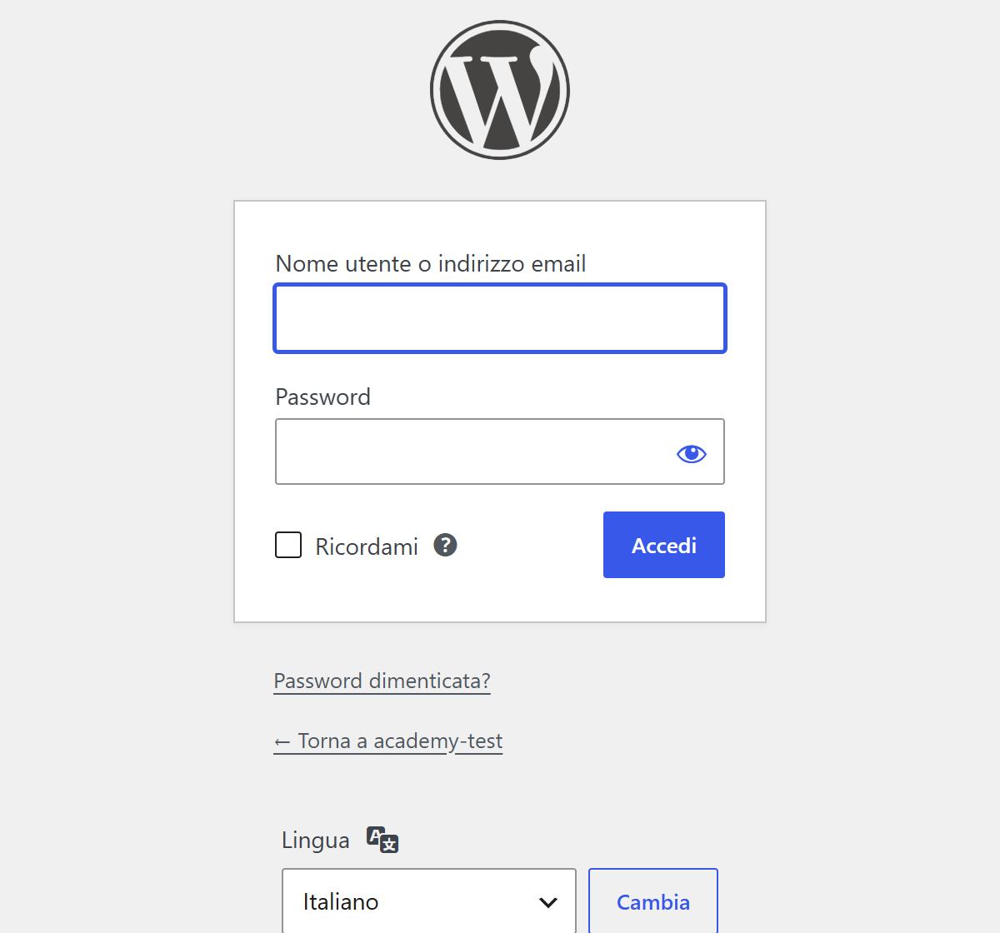

Dopo l'accesso vedi il menu a sinistra con **Academy**, **Le mie vendite** e **Profilo**. Il lavoro si fa tutto da **Academy**.

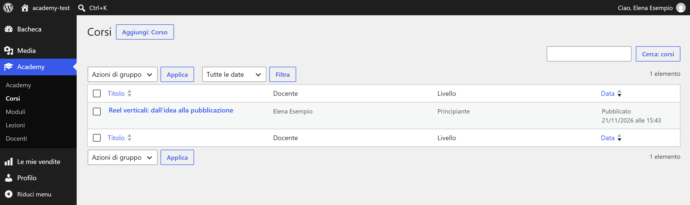

## 2. Compilare la tua scheda

La tua scheda è la pagina che gli studenti vedono quando cliccano sul tuo nome, e il riquadro "Il docente" che compare
nelle pagine dei tuoi corsi.

1. Menu **Academy → Docenti**, poi clicca sul tuo nome.
2. **Descrizione**: nella casella di testo grande scrivi la tua presentazione (chi sei, cosa fai, con chi lavori).
3. **Immagine in evidenza** (a destra): è la tua **foto**. Clicca **Imposta immagine in evidenza** e carica una foto, meglio verticale.

   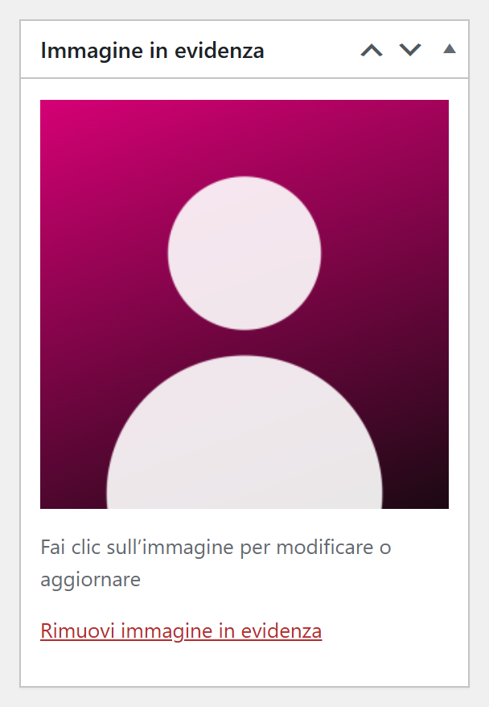

4. Più in basso trovi il riquadro **Scheda pubblica**, con questi campi:

   - **Frase di presentazione**: una riga breve sotto il nome (massimo 140 caratteri).

     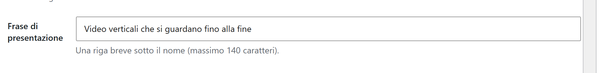

   - **Copertina**: una grande immagine orizzontale in cima alla tua pagina. Clicca **Scegli immagine**.

     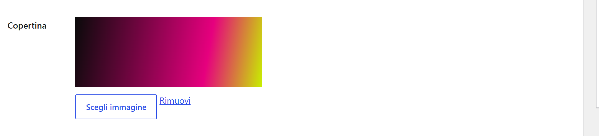

   - **Colore**: il colore di pulsanti ed evidenze nelle tue pagine. Se lo lasci vuoto vale il colore dell'academy.

     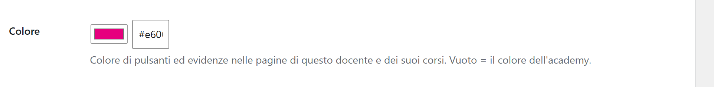

   - **Canali e numeri**: per ogni canale scegli la piattaforma, scrivi il profilo, il link, i **follower** (solo cifre, per esempio
     `82400`) e l'**engagement rate** in percentuale (per esempio `4,6`). Fino a 6 canali. In **Numeri aggiornati a** scrivi
     quando hai letto i dati. Nella tua pagina compaiono i follower totali e l'engagement medio.

     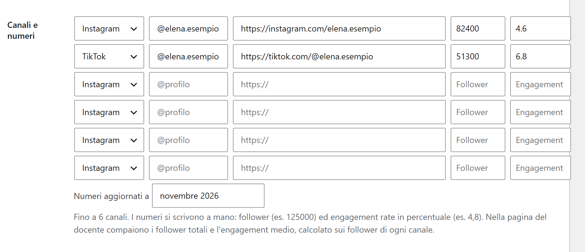

   - **Link**: sito, newsletter, altri indirizzi (fino a 6).

     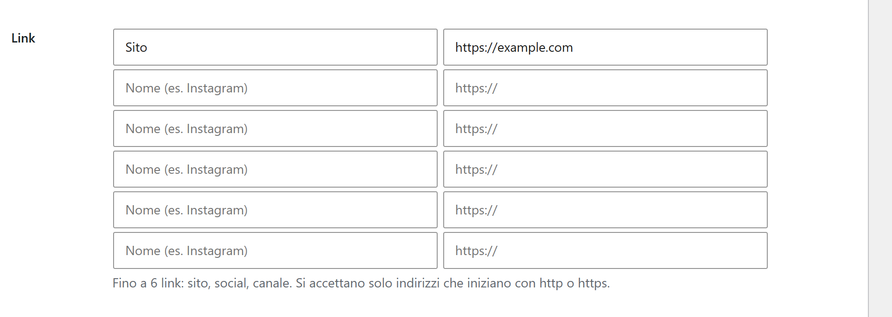

5. Premi **Aggiorna** in alto a destra per salvare.

I numeri danno autorevolezza: tienili aggiornati e scrivi sempre la data. L'engagement rate si ricava dalle statistiche del social
(interazioni diviso follower, per cento): usa il valore che ti indica la piattaforma.

Così la vede uno studente:

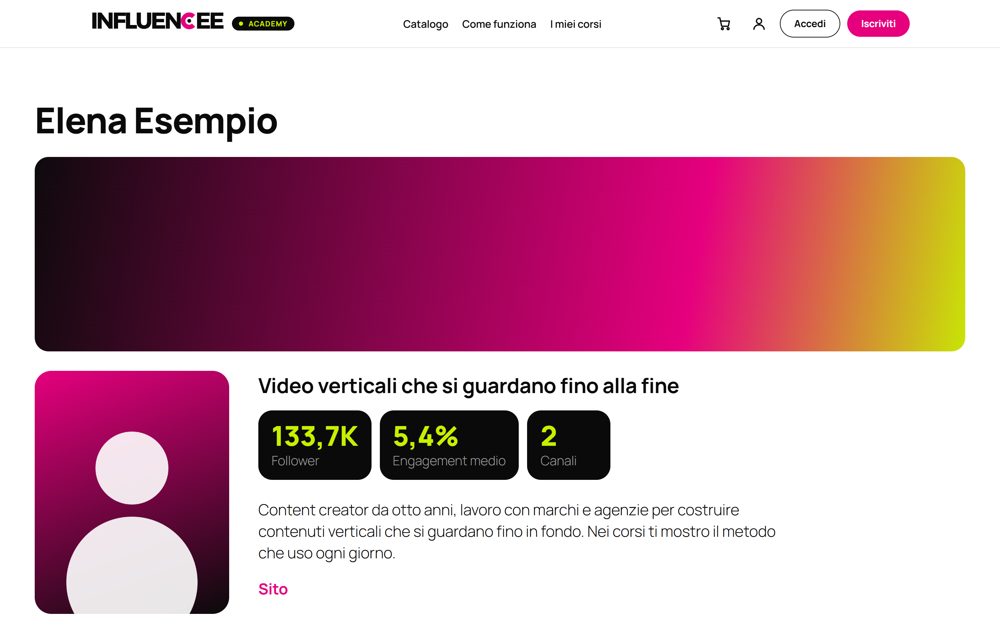

## 3. Creare un corso

1. **Academy → Corsi → Aggiungi: Corso** (il pulsante in alto).

   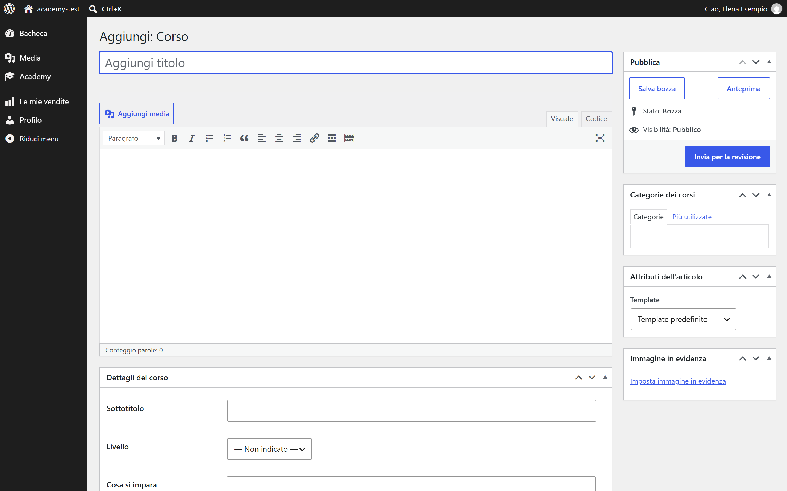

2. **Titolo** e **descrizione**: cosa trova lo studente, in poche righe.
3. **Dettagli del corso**: sottotitolo, livello, **Cosa si impara** (una voce per riga) e **A chi è rivolto** (una voce per riga).

   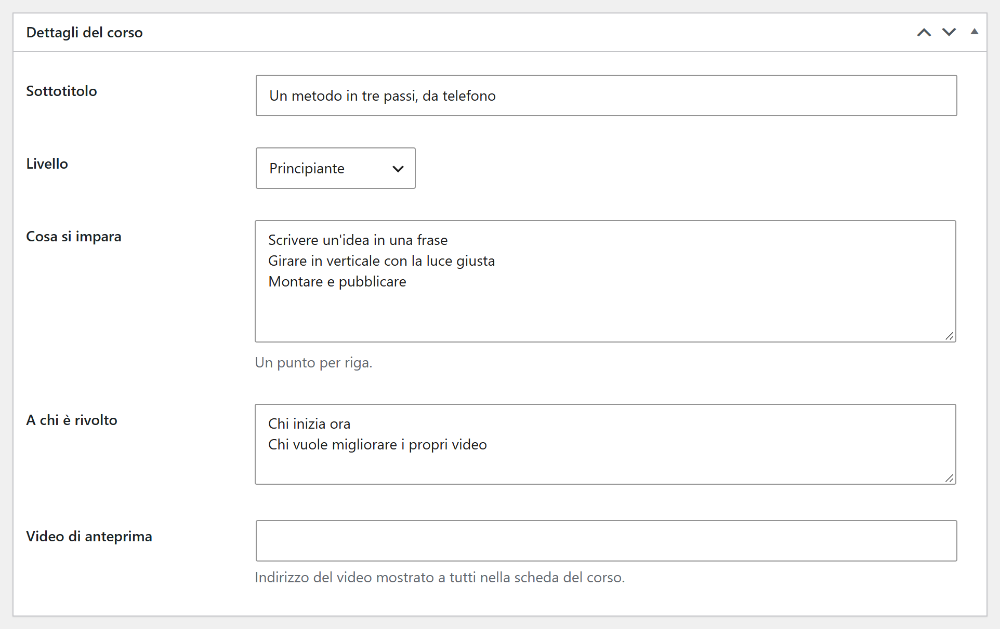

4. **Immagine in evidenza** (a destra): è la **copertina del corso**, quella che si vede nel catalogo. Se il sito è in formato
   verticale, usa un'immagine verticale.

   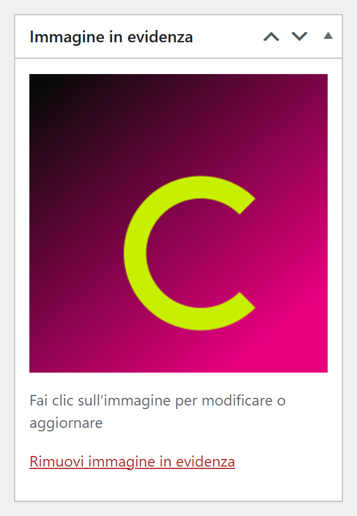

5. Il corso viene collegato a te in automatico: non devi scegliere il docente.

Premi **Salva bozza** quando vuoi fermarti: puoi riprendere più tardi.

## 4. Aggiungere moduli e lezioni

Il corso si divide in **moduli** (i capitoli) e in **lezioni** (i video). Si fa tutto dal riquadro **Programma del corso**, dentro il corso.

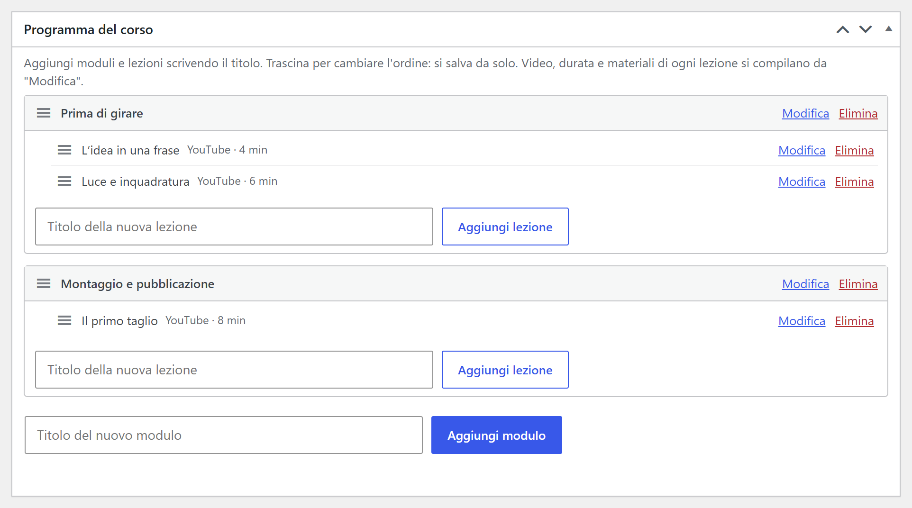

1. Scrivi il titolo del primo modulo e premi **Aggiungi modulo**.
2. Dentro il modulo scrivi il titolo di una lezione e premi **Aggiungi lezione**. Ripeti per ogni lezione.
3. Per cambiare l'ordine **trascina** moduli e lezioni dal simbolo a tre righe. Si salva da solo.
4. Per compilare una lezione premi **Modifica** accanto al suo nome (vedi il punto 5).

## 5. Compilare una lezione

Apri la lezione con **Modifica**. Nel riquadro **Video e opzioni**:

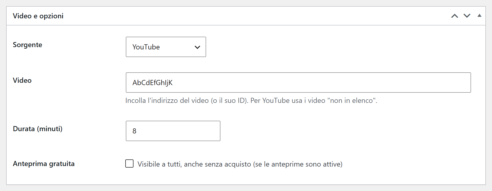

- **Sorgente**: YouTube oppure Vimeo.
- **Video**: incolla l'**indirizzo del video** (o solo il suo codice). Per YouTube usa i video **"non in elenco"**: così li vede solo chi
  ha accesso al corso. Funzionano anche i video verticali (gli **Short**).
- **Durata (minuti)**: aiuta lo studente a capire quanto manca.
- **Anteprima gratuita**: spunta se questa lezione deve vedersi anche senza acquisto, per far conoscere il corso.

Nel riquadro **Materiali** puoi aggiungere i file da scaricare (schede, modelli, PDF).

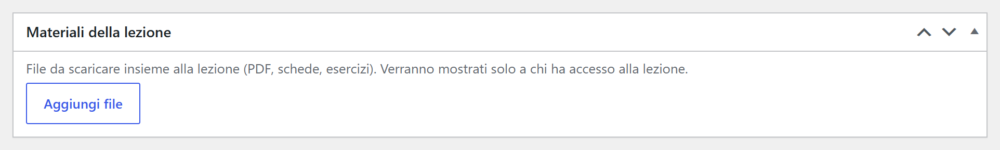

## 6. Inviare il corso alla revisione

Quando il corso è pronto, nel riquadro **Pubblica** premi **Invia per la revisione**. Il titolare dell'academy controlla, imposta il
prezzo e pubblica il corso insieme ai suoi moduli e alle sue lezioni.

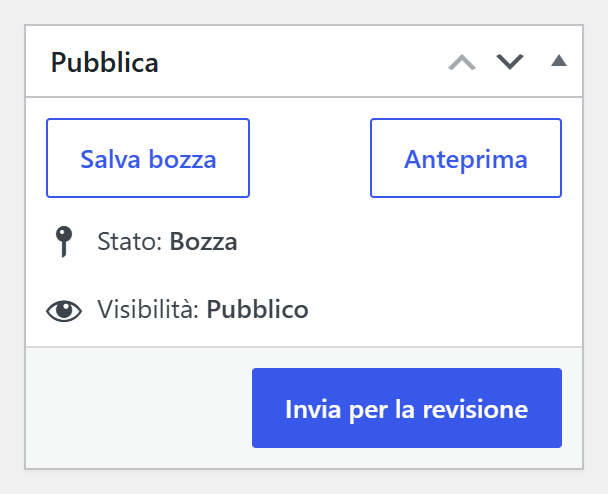

Se vuoi correggere un corso già pubblicato, aprilo, cambia quello che serve e premi **Aggiorna**.

Così lo vede uno studente:

## 7. Le tue vendite

La voce **Le mie vendite** del menu mostra gli acquisti dei tuoi corsi e la tua quota, in sola lettura. I pagamenti ai docenti
avvengono fuori dal sito, secondo gli accordi con il titolare.

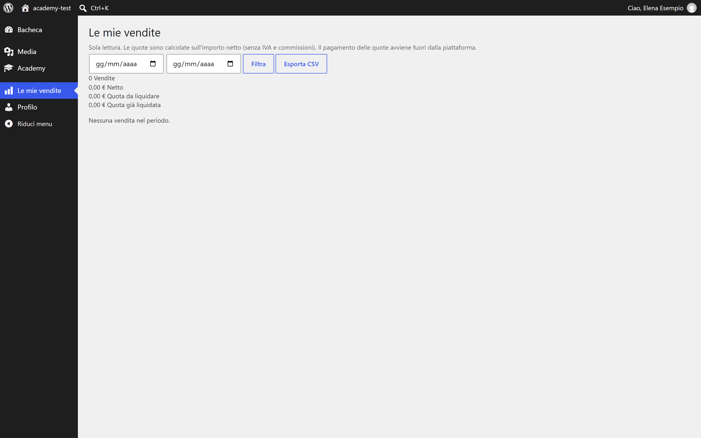

## Domande frequenti

**Non vedo il prezzo del corso.** È giusto così: lo imposta il titolare quando pubblica.

**Ho premuto "Invia per la revisione" ma il corso non è online.** Deve prima pubblicarlo il titolare. Se hai urgenza, scrivigli.

**Non trovo il video della lezione sul sito.** Controlla che su YouTube sia "non in elenco" (o "pubblico") e non "privato": un video
privato non si può incorporare.

**Voglio cambiare la mia foto.** Apri la tua scheda (Academy → Docenti), cambia l'**Immagine in evidenza** e premi **Aggiorna**.

**Non riesco più ad accedere.** Dalla pagina di accesso usa **Password dimenticata?**, oppure chiedi al titolare.
